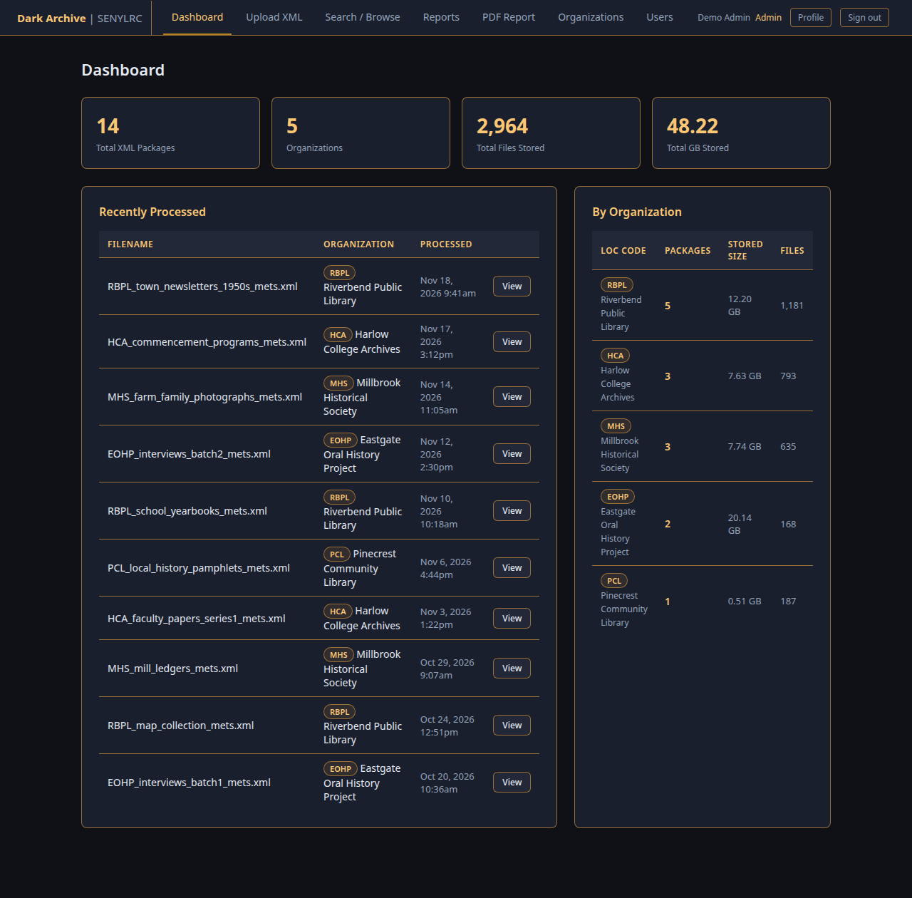
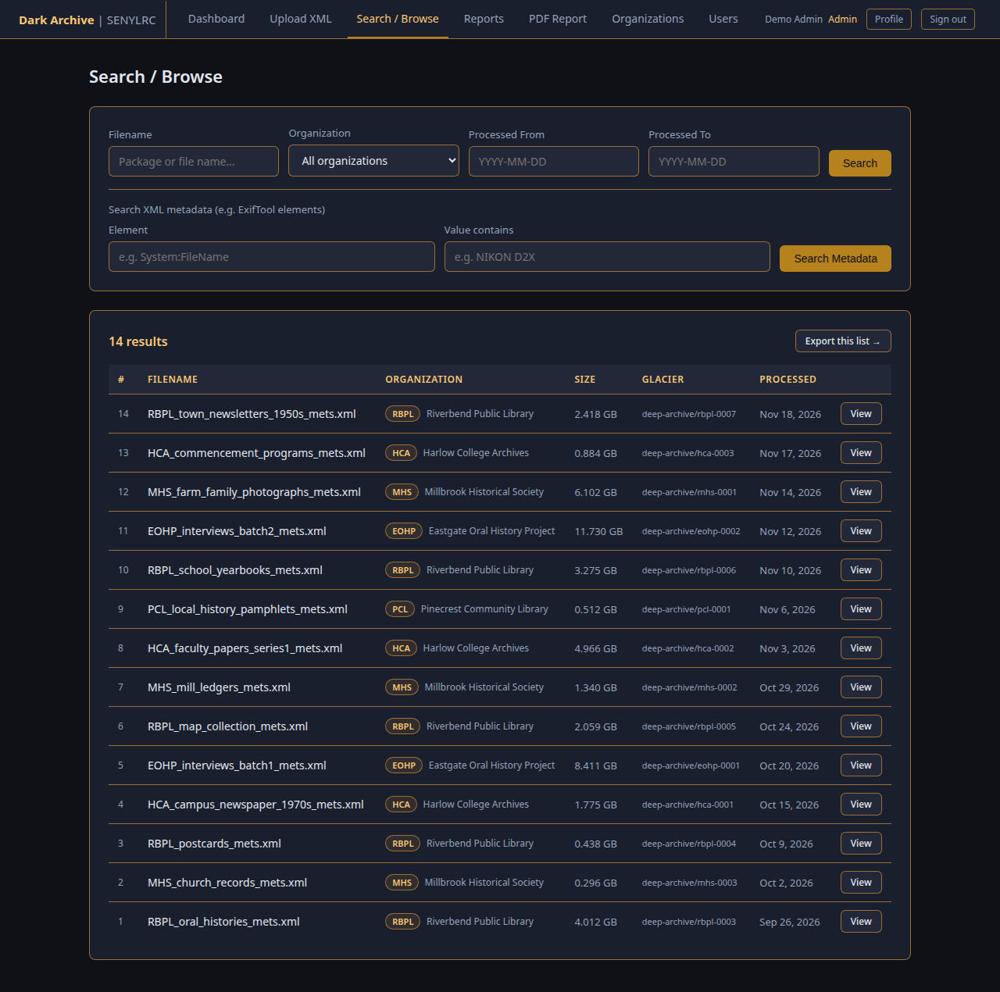
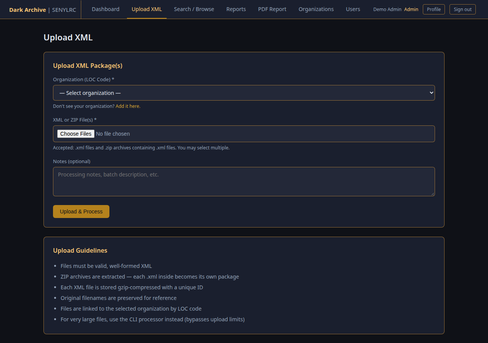

# Dark Archive — XML Package Manager

A PHP/MySQL admin dashboard for ingesting, searching and reporting on
Archivematica METS/PREMIS XML packages held in a digital preservation dark
archive.

## Screenshots

> **Sample data.** These images are rendered from the app's real pages and
> stylesheet, but every organization, package name and figure shown is
> fabricated. No production data appears in this repository.

**Dashboard** — totals, recently processed packages, and a per-organization breakdown.



**Search / Browse** — filter by filename, organization and date, or search the extracted XML metadata.



**Upload** — admins upload `.xml` files or `.zip` archives containing them.



---

## Setup for darkarchive.senylrc.org

---

### 1. Create the MySQL database

```sql
CREATE DATABASE darkarchive CHARACTER SET utf8mb4 COLLATE utf8mb4_unicode_ci;
CREATE USER 'darkarchive_user'@'localhost' IDENTIFIED BY 'your_strong_password';
GRANT ALL PRIVILEGES ON darkarchive.* TO 'darkarchive_user'@'localhost';
FLUSH PRIVILEGES;
```

Then run the schema:
```bash
mysql -h <your-rds-endpoint> \
  --ssl-ca=/etc/mysql-certs/global-bundle.pem \
  -u <admin_user> -p darkarchive < deploy/schema.sql
```

---

### 2. Create the .env file

Configuration lives in `.env`, **not** in PHP — `includes/config.php` reads it
at startup via `load_env()` and defines the constants from there. Do not add
`define()` calls to `config.php`.

```bash
cp .env.example .env
sudo chown root:www-data .env
sudo chmod 640 .env
```

Fill in `DB_HOST`, `DB_PASS`, `RECAPTCHA_SITE_KEY`, `RECAPTCHA_PROJECT` and
`GOOGLE_CREDENTIALS_FILE`. `.env` sits in the app root, above the DocumentRoot,
so it is never web-served.

`load_env()` takes the first readable file from `/var/www/.env`, then
`/var/www/darkarchive/.env`. Note the precedence — an existing `/var/www/.env`
wins silently, and edits to the app-root copy will appear to do nothing.
Confirm which file is actually in effect:

```bash
sudo -u www-data php -r "require '/var/www/darkarchive/includes/config.php'; echo \$_ENV['_ENV_FILE'] ?? '(none - using defaults)', PHP_EOL;"
```

If it prints `(none - using defaults)`, `.env` was not found or is not readable
by `www-data`, and the app silently falls back to `DB_HOST=localhost` with an
empty password.

---

### 3. Create the uploads and dropbox directories

```bash
sudo mkdir -p /var/www/darkarchive/uploads
sudo mkdir -p /var/www/darkarchive/dropbox
sudo chown www-data:www-data /var/www/darkarchive/uploads
sudo chmod 755 /var/www/darkarchive/uploads
sudo chmod 755 /var/www/darkarchive/dropbox
```

---

### 4. Apache VirtualHost (with SSL)

```bash
sudo cp darkarchive-apache.conf /etc/apache2/sites-available/darkarchive.conf
sudo a2ensite darkarchive.conf
sudo a2enmod ssl headers
sudo systemctl reload apache2
```

SSL certificate was obtained via:
```bash
sudo certbot certonly --dns-route53 -d darkarchive.senylrc.org
# Cert: /etc/letsencrypt/live/darkarchive.senylrc.org/fullchain.pem
# Key:  /etc/letsencrypt/live/darkarchive.senylrc.org/privkey.pem
```

---

### 5. PHP requirements

- PHP 8.0+
- Extensions: `pdo`, `pdo_mysql`, `simplexml`, `dom`, `zip`

```bash
php -m | grep -E 'pdo|mysql|xml|dom|zip'
sudo apt install php-zip   # if zip is missing
```

---

### 6. Python requirements (PDF reports)

```bash
sudo pip install reportlab pymysql --break-system-packages
```

---

### 7. Composer dependencies (reCAPTCHA)

```bash
cd /var/www/darkarchive
composer require google/cloud-recaptcha-enterprise
```

---

### 8. Google reCAPTCHA Enterprise setup

The site uses reCAPTCHA Enterprise for login and password reset protection.

**Credentials:**
- Site key: `6Lf5nSItAAAAAPIIPCpg6o5J0hpGj75ZlOUKA8lP`
- Google Cloud Project: `analog-primer-389917`

**Service account setup:**

1. Go to https://console.cloud.google.com/iam-admin/serviceaccounts?project=analog-primer-389917
2. Create service account `darkarchive-recaptcha` with role **reCAPTCHA Enterprise Agent**
3. Download the JSON key file
4. Place it on the server:

```bash
scp service-account-key.json user@server:/tmp/
sudo mv /tmp/service-account-key.json /var/www/darkarchive/service-account-key.json
sudo chown root:www-data /var/www/darkarchive/service-account-key.json
sudo chmod 640 /var/www/darkarchive/service-account-key.json
```

**Where `.env` lives.** `load_env()` takes the first readable file from:

1. `/var/www/.env`
2. `/var/www/darkarchive/.env`  ← normal location (app root)

Both sit above the DocumentRoot (`public/`), so neither is reachable by URL.
Note the precedence: if `/var/www/.env` exists it wins, and edits to the app-root
copy will appear to do nothing. Set permissions with:

```bash
sudo chown root:www-data /var/www/darkarchive/.env
sudo chmod 640 /var/www/darkarchive/.env
```

Confirm which file is in effect:

```bash
sudo -u www-data php -r "require '/var/www/darkarchive/includes/config.php'; echo \$_ENV['_ENV_FILE'] ?? '(none - using defaults)', PHP_EOL;"
```

5. Point the application at the key — add to `.env`:
```
GOOGLE_CREDENTIALS_FILE=/var/www/darkarchive/service-account-key.json
```

   The app builds the credentials explicitly from this path, so it behaves
   identically under mod_php, PHP-FPM, and cron. Do **not** rely on a
   `GOOGLE_APPLICATION_CREDENTIALS` environment variable: `/etc/apache2/envvars`
   is not read by PHP-FPM pools, and cron does not inherit it either.

   Leaving `GOOGLE_CREDENTIALS_FILE` blank falls back to Application Default
   Credentials, i.e. the old environment-variable behaviour.

6. Restart Apache:
```bash
sudo systemctl restart apache2
```

7. Verify the credentials load **as the web server user** — this exercises the
   same code path the login page uses, and names the specific problem
   (missing file, wrong owner, bad JSON) instead of failing generically:
```bash
sudo -u www-data php -r "
require '/var/www/darkarchive/includes/config.php';
require '/var/www/darkarchive/includes/recaptcha.php';
\$err = '';
\$c = recaptcha_credentials(\$err);
echo (\$err ?: 'reCAPTCHA credentials OK (' . (\$c ? 'service account' : 'ADC fallback') . ')'), PHP_EOL;
"
```

---

### 9. Email notifications (Postfix relay to Gmail)

The server uses Postfix as a relay. All outgoing mail uses:
- From: `noreply@yourdomain.org`
- NOC copy: `noc@yourdomain.org` (account creation, password resets, password changes)

Test the relay:
```bash
echo "Test from darkarchive" | mail -s "Test" your@email.com
```

Email constants are set in `includes/mailer.php`:
```php
define('MAIL_FROM',    'noreply@yourdomain.org');
define('MAIL_NOC',     'noc@yourdomain.org');
define('SITE_URL',     'https://darkarchive.senylrc.org');
```

---

### 10. Cron job (dropbox processor, Mon–Fri 8am–4pm every 5 min)

```bash
sudo crontab -e
```

Add:
```
*/5 8-16 * * 1-5 /usr/bin/php /var/www/darkarchive/process_uploads.php /var/www/darkarchive/dropbox >> /var/log/darkarchive_process.log 2>&1
```

Create the log file:
```bash
sudo touch /var/log/darkarchive_process.log
sudo chown root:root /var/log/darkarchive_process.log
```

The cron job also cleans up expired/used password reset tokens on every run.

---

### 10b. Cron job (data quality report, Monday mornings)

`report_data_quality.php` emails `noc@yourdomain.org` a list of packages missing
a recorded stored size and/or Glacier storage location — both are entered by
hand via `view.php`'s Edit Package form and have no automatic source — plus
any storage locations shared by more than one package (almost always a
copy/paste mistake in that form). It only sends mail when there is something
to report, so a clean week produces no email at all.

```bash
sudo crontab -e
```

Add:
```
0 7 * * 1 /usr/bin/php /var/www/darkarchive/report_data_quality.php >> /var/log/darkarchive_data_quality.log 2>&1
```

Create the log file:
```bash
sudo touch /var/log/darkarchive_data_quality.log
sudo chown root:root /var/log/darkarchive_data_quality.log
```

Run it by hand any time — `--dry-run` prints the report without emailing it,
`--always` also sends a clean "all clear" email instead of staying silent:
```bash
php /var/www/darkarchive/report_data_quality.php --dry-run
```

The script's own exit code reflects whether it *ran* successfully (database
reachable, mail accepted for local delivery) — not whether it found issues,
since finding issues is its normal job. A cron-monitoring tool can key off
that exit code without a false alarm every time the report has content.

---

### 10c. Cron job (S3 reconciliation, monthly)

`report_s3_reconciliation.php` cross-checks `packages` against the S3 bucket
that holds the actual archived assets (darkarchive itself only stores the
descriptive METS XML). It emails `noc@yourdomain.org`:

- packages with a recorded S3 location that no longer exists there
- packages with no recorded location and no matching object found (best-effort
  filename matching — see the header comment in the script for exactly how)
- packages with no recorded location where a likely match WAS found — an easy
  fix, just fill in `glacier_location`
- packages whose recorded location points at the wrong bucket entirely
- S3 objects that exist under the archive naming convention with no
  corresponding package at all

**Install the AWS SDK first** (not required by the rest of the app — only
this script uses it):
```bash
cd /var/www/darkarchive
composer require aws/aws-sdk-php
```

**Add to `.env`** (see `.env.example`): `AWS_ACCESS_KEY_ID`,
`AWS_SECRET_ACCESS_KEY`, `AWS_REGION`, `S3_BUCKET`.

The IAM user this script runs as should be locked to exactly what it does —
list and check existence of objects, only under the one prefix this app
knows about (`digital-archive-senylrc/`), nothing else in the bucket, and no
write/delete of any kind:

```json
{
    "Version": "2012-10-17",
    "Statement": [
        {
            "Sid": "ListDarkArchivePrefixOnly",
            "Effect": "Allow",
            "Action": "s3:ListBucket",
            "Resource": "arn:aws:s3:::<your-bucket>",
            "Condition": {
                "StringLike": { "s3:prefix": "digital-archive-senylrc/*" }
            }
        },
        {
            "Sid": "CheckObjectExistenceOnly",
            "Effect": "Allow",
            "Action": "s3:GetObject",
            "Resource": "arn:aws:s3:::<your-bucket>/digital-archive-senylrc/*"
        }
    ]
}
```

`s3:GetObject` is listed (not just `s3:ListBucket`) because IAM has no separate
"HeadObject" action — the SDK's existence check (`doesObjectExistV2`, a
HeadObject call under the hood, no object body ever transferred) is
authorized under the same permission as a real download. This policy cannot
download, write, or delete anything regardless — it can only list keys and
ask "does this one exist".

**Trade-off of the prefix condition:** if a `glacier_location` value is ever
typed pointing somewhere else in the bucket (a typo, or content filed outside
the `digital-archive-senylrc/` convention), the existence check for that one
package gets `AccessDenied` rather than a clean answer — `s3_object_exists()`
catches that and reports it as "missing", which would be a false positive.
If that turns out to matter in practice, widen the `Resource` in the second
statement to `arn:aws:s3:::<your-bucket>/*` (drop the prefix) — this
script never needed the `s3:prefix` condition removed to do its job, so
that's a real loosening, not just a formality, and worth deciding
deliberately rather than defaulting into.

```bash
sudo crontab -e
```

Add (first of the month, 6am — listing the whole bucket is heavier than the
weekly data-quality report, so this runs less often):
```
0 6 1 * * /usr/bin/php /var/www/darkarchive/report_s3_reconciliation.php >> /var/log/darkarchive_s3_reconciliation.log 2>&1
```

Create the log file:
```bash
sudo touch /var/log/darkarchive_s3_reconciliation.log
sudo chown root:root /var/log/darkarchive_s3_reconciliation.log
```

Run it by hand any time — same `--dry-run` / `--always` flags and exit-code
convention as `report_data_quality.php`:
```bash
php /var/www/darkarchive/report_s3_reconciliation.php --dry-run
```

---

### 11. Default admin account

After running `deploy/schema.sql`, log in with:
- Username: `admin`
- Password: `password`

**Change this immediately** via the Users page after first login.

---

### Stored package format

Each ingested METS XML is packaged as a gzip-compressed tar in `uploads/`, named:

```
<LOC>-<create-date>-<cleaned premis:originalName>.tar.gz
e.g. NWKPLD-2026-06-18-maverick_festival_photographs.tar.gz
```

- `create-date` is the first `mets:dmdSec/@CREATED`, falling back to
  `mets:metsHdr/@CREATEDATE`, then to ingest time.
- The name is the package-level `premis:originalName` (the first one without a
  `%variable%`), with the LOC code, Archivematica UUIDs, hex blobs, long digit
  runs, ISO dates, `digital-archive-senylrc-` boilerplate, AWS region tokens and
  a trailing `mets` removed. Four-digit years are kept.
- Collisions get `-2`, `-3`, ... appended.
- `download.php` and `view.php` read the XML back out of the tar transparently;
  legacy `.xml.gz` files still work.

---

### File structure

```
darkarchive/
├── public/                  *** Apache DocumentRoot — only this is web-served ***
│   ├── index.php            Dashboard
│   ├── login.php            Login with reCAPTCHA Enterprise
│   ├── logout.php           Session destroy
│   ├── reset_password.php   Password reset request + reset form
│   ├── profile.php          User self-service (email + password)
│   ├── upload.php           Web upload (XML and ZIP) — admin only
│   ├── search.php           Search by filename, org, date, XML element
│   ├── view.php             Package detail + file list + XML preview
│   ├── report.php           Filtered reports + CSV export
│   ├── pdf_report.php       PDF report by organization
│   ├── orgs.php             Organization management — admin only
│   ├── users.php            User management — admin only
│   ├── download.php         XML download (unpacks the .tar.gz on the fly)
│   └── check_duplicates.php AJAX duplicate file checker
├── .env                     Credentials — app root, above the DocumentRoot
├── *-service-key.json       Google service account key — above the DocumentRoot
├── process_uploads.php      CLI processor (XML/ZIP/7z/tar.gz, file or dropbox)
├── backfill_file_counts.php CLI one-off: fills packages.file_count for old rows
├── report_data_quality.php  Cron: emails missing size/location + duplicate locations
├── report_s3_reconciliation.php  Cron: emails packages/S3 objects out of sync
├── generate_pdf_report.py   Python/ReportLab PDF generator
├── composer.json            Declares google/cloud-recaptcha-enterprise + aws/aws-sdk-php
├── STATUS.md                Current work-in-progress handoff notes
├── deploy/
│   ├── darkarchive.conf     Apache vhost (reference copy of the deployed file)
│   ├── schema.sql           Full database schema
│   └── organizations_sync.sql  Idempotent organization roster sync
├── vendor/                  Composer packages (google/cloud-recaptcha-enterprise, aws/aws-sdk-php)
├── includes/
│   ├── config.php           .env loader, DB connection, RDS SSL cert path
│   ├── auth.php             Session management, login/access helpers
│   ├── security.php         CSRF, secure session config, headers, CSV escaping
│   ├── layout.php           Shared nav + dark-theme CSS
│   ├── mailer.php           Email notification helpers
│   ├── recaptcha.php        Google Cloud reCAPTCHA Enterprise verification
│   ├── archive.php          Archive extract/package + stored-XML reader
│   ├── xml_metadata.php     METS element/date/originalName extraction
│   └── s3_reconcile.php     S3 key parsing + packages<->S3 identity matching
├── dropbox/                 Ingest staging (LOC-prefixed files or LOC folders)
└── uploads/                 Stored packages (.tar.gz, www-data writable)
```

---

### CLI usage

**Single file:**
```bash
php /var/www/darkarchive/process_uploads.php /path/to/file.xml LOCCODE
php /var/www/darkarchive/process_uploads.php /path/to/file.zip LOCCODE
```

**Dropbox folder** (subfolders named by LOC code, sorted alphabetically):
```bash
php /var/www/darkarchive/process_uploads.php /var/www/darkarchive/dropbox
```

Dropbox structure:
```
dropbox/
  NANB/      ← Bard College
    file.xml
  NHIGS/     ← SENYLRC
    file.zip
```

Processed → `<LOC_CODE>/processed/`
Invalid XML → `<LOC_CODE>/rejected/`
Duplicates → `<LOC_CODE>/processed/` (silently skipped, not re-inserted)

**File lists (View → Show files, Reports → File List)** come from each
package's METS `USE="original"` file group — one row per original file, the
same set the Files count uses — via `cached_mets_original_files()` in
`includes/xml_metadata.php`. Packages with no such group fall back to
ExifTool `FileName` rows in `file_metadata`. Each package's list is parsed
once and cached in `uploads/.filelists/` (refreshed automatically if the
package file changes). To pre-build or rebuild the cache:
```bash
php /var/www/darkarchive/backfill_file_lists.php
```
The Reports file list stops after 20 seconds of first-time parsing and says
so; reloading continues from the cache.

---

### User roles

| Feature | Admin | Read-only |
|---------|-------|-----------|
| Upload XML/ZIP | ✓ | ✗ |
| Manage organizations | ✓ | ✗ |
| Manage users | ✓ | ✗ |
| Search / browse | All orgs | Assigned orgs only |
| Reports / PDF | All orgs | Assigned orgs only |
| View packages | All orgs | Assigned orgs only |
| Profile (email/password) | ✓ | ✓ |

Read-only users can be assigned to multiple organizations.

#### Council access

Each of the six library councils exists both as a row in `library_councils`
and as an ordinary organization (same LOC code, e.g. `NSYCNL` = Central New
York Library Resources Council). A read-only user assigned to a council's
organization can also see every organization whose **Library Council** is
set to that council on the Organizations page — e.g. a user assigned to
Central New York sees all Central New York members' packages, searches,
reports and PDFs.

- Membership comes from `organizations.council_id`; an org left
  "Unassigned" (—) is not visible to council users.
- It is computed on every page load (`refresh_user_orgs()` in
  `includes/auth.php`), so assigning an org to a council takes effect
  immediately — no need for the user to log out.
- The Users page lists, under each user's organizations, which councils they
  cover and how many member orgs that adds.
- The Organizations page can be filtered by council (or "Unassigned") and by
  name/LOC code, and sorted by any column. The filter is in the URL, e.g.
  `orgs.php?council=none` lists orgs still needing a council.
- Council and organization rows are matched in PHP, not with a SQL join, so a
  collation difference between the two tables can't silently break access.

---

### Security features

- CSRF tokens on all POST forms
- Secure session cookies (HttpOnly, Secure, SameSite=Strict)
- Session ID regenerated on login (prevents session fixation)
- Security headers on every response (CSP, HSTS, X-Frame-Options, etc.)
- Apache blocks direct access to `.py`, `.sql`, `includes/`
- All DB queries use PDO prepared statements
- Encrypted RDS connection (TLS with CA cert verification)
- reCAPTCHA Enterprise on login and password reset
- Password reset tokens expire after 1 hour and are single-use
- Email alerts to user + noc@yourdomain.org on account creation, password reset, password change
- The new-account email includes the site URL and a one-time "set your password" link (`password_resets` token, valid `SET_PASSWORD_LINK_DAYS` = 7 days); the admin-entered password is never emailed

---

## Development Notes

This application was developed with assistance from **Claude** (claude.ai),
an AI assistant made by Anthropic (Claude Sonnet 4.6).

Development took place in June 2026 via a pair-programming session where
requirements were gathered conversationally and refined through real-world
testing against the production server at `darkarchive.senylrc.org`.

**Developer:** SENYLRC (Southeastern New York Library Resources Council)
**AI Tool:** Claude Sonnet 4.6 — https://claude.ai
**Date:** June 2026

---

### Sensitive files and the web root

This is handled structurally by the `public/` layout — nothing needs moving.
Only `/var/www/darkarchive/public` is served, so `deploy/`, `README.md`,
`STATUS.md`, `generate_pdf_report.py`, `process_uploads.php`, `.env`, the
service-account key, `includes/`, `vendor/`, `uploads/` and `dropbox/` all sit
above the DocumentRoot and have no URL at all.

The vhost adds a matching `Require all denied` on the app root plus `FilesMatch`
rules for `.sql`, `.py`, `.sh`, `.json`, `.env`, `.md` and dotfiles, so a file
misplaced into `public/` is still not served. See `deploy/darkarchive.conf`.

